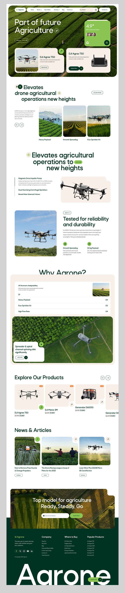
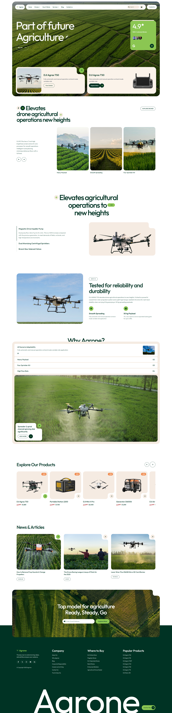

# Agrone — Agricultural Drone Landing Page

A responsive design-to-code showcase recreating the Agrone agricultural drone landing page from a static UI concept. Built with React, TypeScript, and Tailwind CSS.

[](https://buildwithama-agrone.vercel.app) [](https://www.behance.net/gallery/218962789/Agrone-Agriculture-Drone-Landing-Page) [](./LICENSE)

## Design comparison

| Original Design Image | Live Code Render Image |
| --- | --- |
|  |  |

## Features

- Responsive landing page layout with a consistent maximum section width.
- Interactive feature accordions that update the selected feature content and imagery.
- Horizontally scrolling product and operations carousels with navigation controls.
- Video feature area with play and pause controls.
- Product cards with imagery, discounts, original prices, and sale prices.
- Curved, transparent card cutouts and image overlays.
- CTA and footer composition with responsive layout.
- Outfit typography and local project imagery.

## Tech stack

- [React](https://react.dev/) — component-based UI.
- [TypeScript](https://www.typescriptlang.org/) — typed application code.
- [Vite](https://vite.dev/) — development server and production bundler.
- [Tailwind CSS](https://tailwindcss.com/) — utility-first styling, integrated through the Vite plugin.
- [React Icons](https://react-icons.github.io/react-icons/) — interface icons.

## Getting started

### Prerequisites

- [Node.js](https://nodejs.org/) (an active LTS release is recommended)
- npm

### Install and run

```sh
git clone https://github.com/buildwithama01/design_to_code_agrone.git
cd design_to_code_agrone
npm install
npm run dev
```

Vite prints the local development URL in the terminal after startup.

### Available scripts

| Command | Description |
| --- | --- |
| `npm run dev` | Start the local development server. |
| `npm run build` | Type-check and build the production site. |
| `npm run preview` | Preview the production build locally. |
| `npm run lint` | Run ESLint. |

## Project structure

```text
src/
├── assets/        # Local images and other visual assets
└── components/    # Landing page sections and reusable UI components
```

## Live demo

[View the deployed Agrone landing page](https://buildwithama-agrone.vercel.app).

## Credits & Attribution

The original visual concept is **“Agrone Agriculture Drone Landing Page”** by **Rafsan Sam**.

- Design source: [Behance project](https://www.behance.net/gallery/218962789/Agrone-Agriculture-Drone-Landing-Page)
- Designer: [Rafsan Sam on Behance](https://www.behance.net/rafsansam7n7)
- Designer: [Rafsan Sam on Dribbble](https://dribbble.com/Rafsan7n7)

This repository is a code implementation inspired by the credited design. Please refer to the original project for the designer’s terms governing the source artwork.

## License

This project’s source code is available under the [MIT License](./LICENSE). The original design and artwork remain attributed to their respective creator and are not relicensed by this project.
